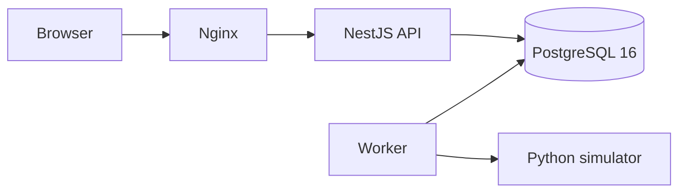

# RenewalDesk

**Для знакомства с проектом:** [как войти и проверить основные сценарии](REVIEWER_GUIDE.md).

Внутреннее приложение для согласования продления ресурсов на 30 календарных дней. React-интерфейс на русском, NestJS API, отдельный worker, PostgreSQL и неизменённый Python-симулятор провайдера. Только вымышленные данные. Облачный деплой не нужен.



Пошаговая проверка кнопок, ролей и автотестов: [инструкция по ручному тестированию](docs/manual-testing.md).

## Запуск

Нужны Docker с Compose v2, Node.js **22.21.1**, npm 10 и `make`. Локально проверяются Docker 28.3.3 / Compose 2.39.2; контейнеры используют Node 22.21.1, PostgreSQL 16.6, Python 3.12.8 и nginx-unprivileged 1.27.3. Зависимости закреплены lockfile. Установите Node из `.nvmrc` (`nvm use`), если системная версия отличается.

```sh
npm ci
make env
make up
```

`make env` создаёт игнорируемый `.env` со случайными локальными секретами и не перезаписывает существующий. Не редактируйте секреты в исходниках. Первый Docker build может быть долгим из-за загрузки образов/пакетов. Для путей с кириллицей Makefile задаёт `COMPOSE_BAKE=false`.

- Приложение: <http://localhost:8080>
- Stoplight Elements: <http://localhost:8080/docs>
- Swagger UI: <http://localhost:8080/docs/swagger>
- OpenAPI: <http://localhost:8080/docs/openapi.json>
- Health / DB readiness: `/health`, `/health/ready`
- Локальная проверка симулятора: <http://localhost:18091/health>

Миграции и core seed выполняются одноразовыми контейнерами перед API/worker. Повторный seed не сбрасывает сроки, историю и заявки. `make migrate`, `make seed`, `make logs` доступны отдельно. `make down` сохраняет том PostgreSQL, но удаляет контейнер провайдера и **теряет его память**. Для проверки восстановления перезапускайте только API/worker; `up --build`/пересоздание всего стека не является сценарием recovery. Worker проверяется по живому процессу и журналу обработки; отдельного HTTP heartbeat endpoint у него нет.

## Вход и наборы данных

Пароль всех локальных тестовых аккаунтов: `demo1234`. В БД хранятся bcrypt-хэши с cost 12.

| Email | Пространство | Права |
|---|---|---|
| initiator.alpha@renewaldesk.test | Alpha | Создание |
| approver.alpha@renewaldesk.test | Alpha | Согласование/отклонение/retry |
| initiator.beta@renewaldesk.test | Beta | Создание |
| universal.alpha@renewaldesk.test | Alpha | Обе роли, без решения своих заявок |

Core по умолчанию: 2 пространства, **18 ресурсов (15 в Alpha, 3 в Beta)**, 4 аккаунта. На новой БД заявок нет; существующие заявки при повторном seed сохраняются. Три обязательных ресурса и их исходные даты/суммы сохранены из задания; дополнительные 15 ресурсов добавлены по запросу владельца. Минимальный приёмочный набор из 3 ресурсов используется только в изолированном `DATASET=test`.

```sh
make demo
```

Demo запускается отдельным Compose-проектом, томом БД и провайдером на <http://localhost:8081> (provider inspection 18092). `.env.demo` создаётся отдельно. 15 ресурсов, 7 аккаунтов, 11 начальных заявок; дополнительно `approver.beta`, `initiator.orion`, `approver.orion` с доменом `@renewaldesk.test`. Исторические completed/rejected и их события помечены как иллюстративные; синтетические UUID не доказывают вызов текущего провайдера. RN-0906 — реальная задача с начальной задержкой 90 секунд. Bootstrap создаёт и проверяет настоящую операцию RN-0903, оставляя заявку в attention; «Повторить обработку» найдёт её через GET. Повтор seed/bootstrap идемпотентен, пока состояние провайдера сохранено. Наборы нельзя накладывать друг на друга: в БД хранится marker.

## API и авторизация

База `/api/v1`; контракты, поля и ошибки в snake_case: [описание API](docs/api-contracts.md). Сервер выводит пользователя/роли/пространство из JWT HttpOnly cookie + отзываемой DB-сессии. Cookie SameSite=Strict, локально Secure=false; для HTTPS/production требуется Secure=true. Авторизация в localStorage не хранится.

```sh
curl -c /tmp/renewaldesk.cookies -H 'Origin: http://localhost:8080' \
  -H 'Content-Type: application/json' \
  -d '{"email":"initiator.alpha@renewaldesk.test","password":"demo1234"}' \
  http://localhost:8080/api/v1/auth/login
curl -b /tmp/renewaldesk.cookies http://localhost:8080/api/v1/auth/csrf
```

Скопируйте `csrf_token` из второго ответа в `X-CSRF-Token` для POST, вместе с Cookie и точным Origin. Срок/сумму/автора клиент не отправляет:

```sh
curl -b /tmp/renewaldesk.cookies -H 'Origin: http://localhost:8080' \
  -H 'X-CSRF-Token: ВСТАВЬТЕ_ТОКЕН' -H 'Content-Type: application/json' \
  -d '{}' http://localhost:8080/api/v1/resources/res-a-01/renewals
```

Для Swagger/Stoplight сначала войдите в приложение в том же браузере. Выполните GET `/auth/csrf`, вставьте токен в заголовок соответствующего POST. Cookie отправляется браузером same-origin; вручную вводить Cookie/JWT не нужно. Origin браузер выставляет сам. Статические docs assets локальные. 401 — вход, 403 — роль/пространство/своё решение/CSRF, 404 — объект отсутствует, 409 — бизнес-конфликт. Никакого обхода авторизации для Try It.

## Надёжность и перезапуск

`pending_approval → processing → completed`, либо `pending_approval → rejected`, либо `processing → requires_attention → processing` по retry. Одна активная заявка на ресурс закреплена partial unique index. Согласование, durable job и audit фиксируются одной транзакцией, без сетевых вызовов. Worker использует SKIP LOCKED, lease и возрастающий fencing token. Ключ и четыре поля payload неизменяемы.

POST-попытка резервируется в БД **до** отправки. После 503/timeout фаза GET и задержка сохраняются. GET не увеличивает POST-счётчик; после третьей попытки выполняется заключительный GET. Retry использует ту же заявку/job/key/payload, сбрасывает счётчик цикла и сохраняет общий. Подтверждение валидируется по UUID, status, started_count и полному payload. Новый срок из снимка, completed/job done и audit фиксируются атомарно. Если текущий ресурс не совпадает со снимком, заявка требует внимания, подтверждение провайдера сохраняется.

Автоматическая проверка с реальным убийством процессов:

```sh
make test-recovery
```

Harness создаёт свежий отдельный Docker provider, использует изолированную test-БД, убивает API и worker через SIGKILL после сохранённого 503, запускает их снова и доказывает тот же operation_id, одну операцию/started_count=1, дату 2027-03-31 и отсутствие повторного изменения. DB и provider не перезапускаются внутри сценария.

Ручная проверка на **свежем core-наборе**:

1. До запуска выставьте `RETRY_DELAY_MS=20000` в `.env`, затем `make up`. Не сбрасывайте существующие данные.
2. Инициатор Alpha создаёт res-a-01. Срок остаётся 01.03.2027. Второе создание получает 409. Другой согласующий Alpha согласовывает заявку.
3. Дождитесь «Результат операции пока не подтверждён» и первой POST-попытки. Скопируйте ключ операции из сведений заявки. До следующей проверки выполните:
   ```sh
   docker compose -p renewaldesk-core stop api worker
   docker compose -p renewaldesk-core start api worker
   ```
   PostgreSQL и provider оставьте работающими.
4. Дождитесь completed и срока 31.03.2027. Проверка всех ключей ресурса:
   ```sh
   curl 'http://localhost:18091/stats?resource_id=res-a-01'
   curl --get 'http://localhost:18091/renewals/ВСТАВЬТЕ_URL_ENCODED_KEY'
   ```
   Для ключа `renewal:…` двоеточие кодируется `%3A`; произвольный ключ кодируйте целиком. Ожидаются `operation_count=1`, `started_count=1` и тот же `operation_id` до/после рестарта. По GET `/api/v1/renewals/:id` доступны ключ, событие и фактический срок ресурса.
5. Отклоните res-a-02: срок 20.05.2027, `/stats?resource_id=res-a-02` → 0. Ещё один restart worker не меняет уже завершённый срок.

Внешняя однократность обеспечивается только контрактом идемпотентного симулятора при сохранённой памяти. Это не глобальное exactly-once. При падении между reservation и send счётчик консервативно считает возможную отправку; ручной retry открывает новый цикл. При подтверждённом локальном mismatch UI не редактирует ресурс: оператору нужно исследовать audit/снимок/провайдера и согласовать корректировку, затем retry; подтверждённая операция не отправляется заново.

## Проверки и разработка

```sh
make lint
make typecheck
make build
make test
make test-integration
make test-recovery
npx playwright install chromium
make test-e2e
# Полная последовательность с изолированным test startup:
make verify
```

Интеграционные тесты используют только `renewaldesk_test` на loopback 55432 и test provider 18191 из `compose.test.yaml`. Они явно очищают **только test-БД**; не запускайте одновременно integration/E2E над одной БД. Тестовые ресурсы отдельны от core/demo. Recovery требует Docker CLI. E2E запускает тестовые API/worker/Vite-процессы и работает с оригинальным Docker provider, 1440×900 и 390×844. Артефакты: `apps/web/test-results/`, `apps/web/playwright-report/`. Для системного Chrome fallback используется wrapper, отсоединяющий диагностический stderr (обходит зависание macOS helper при закрытии; протокол/trace не меняет). Можно использовать установленный Chrome: `PLAYWRIGHT_EXECUTABLE_PATH='/Applications/Google Chrome.app/Contents/MacOS/Google Chrome' make test-e2e`.

Локальный frontend: `npm run dev -w apps/web`; API: `npm run build -w apps/server`, `npm run start:api -w apps/server`, worker: `npm run start:worker -w apps/server`. Нужны корректные `DATABASE_URL`, секреты, `APP_ORIGIN` (для Vite `http://localhost:5173`) и `PROVIDER_BASE_URL`; DB мигрируется через `npm run migrate`, core seed — `npm run seed:core`. Compose URL `postgres` предназначен контейнерам, с хоста укажите свой loopback test/dev URL.

GitHub Actions запускает ту же `make verify`, сохраняет отчёты и dependency audit. Наличие workflow не означает успешный удалённый CI: он ещё не запускался. Реальные результаты и ограничения — в [docs/progress.md](docs/progress.md). [План](docs/implementation-plan.md), [надёжность](docs/reliability.md), [безопасность](docs/security.md), [ADR](docs/adr/) сохраняют исходные инженерные решения.

Реализация продолжена после Claude Code с помощью Codex. Код проверяется инструментами и тестами; независимую ручную приёмку владельца это не заменяет. Публикация репозитория и отправка задания остаются за владельцем.

Известный результат dependency audit на 2026-11-12: `npm audit --omit=dev` сообщает 8 moderate (транзитивные uuid/glob/minimatch и цепочки Sequelize/CLI), без high/critical в production-зависимостях. Полный build/dev-граф Stoplight имеет дополнительные upstream advisories; статический bundle не считается автоматически безопасным из-за переноса пакета в devDependencies. Не применялся `audit fix --force`, предлагающий несовместимые major/downgrade замены утверждённого стека. Dev-сервисы и документацию не следует публиковать как production deployment; детали и фактические проверки сохранены в progress.
