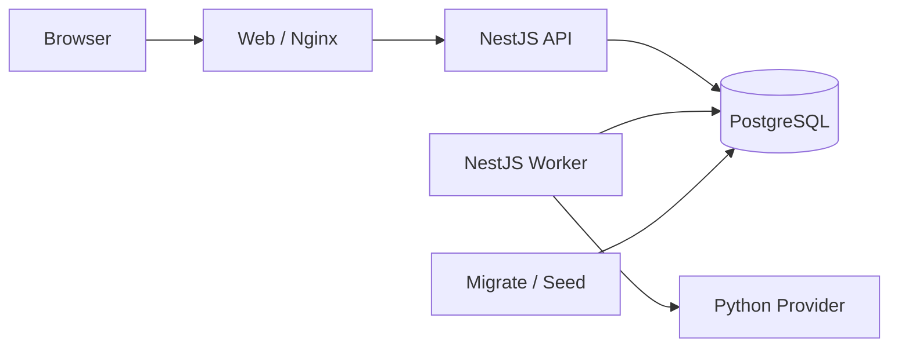

# Architecture & database

## Runtime
Один монорепозиторий, modular monolith NestJS и отдельно запускаемый worker из той же codebase/image. Не дробить domain на сетевые микросервисы. API никогда не ожидает внешнее продление в HTTP handler; DB — источник истины. PostgreSQL-backed durable job — outbox-style атомарная запись команды, не внешний event bus.



Предлагаемая структура (уточнить только при необходимости):
```
apps/api/src/{auth,users,workspaces,resources,renewals,audit,overview,health,common}
apps/worker/src/{bootstrap,runner,provider}
apps/web/src/{app,features,components,lib,styles}
packages/database/{models,migrations,seeders,config}
packages/domain/{renewals,jobs,audit}
packages/contracts/{dto,types}
infrastructure/{provider,nginx}
tests/{integration,e2e,fixtures,helpers}
docs/adr/
references/
```
Общие backend repositories/services/domain services не дублировать. Frontend не импортирует Sequelize/Nest runtime. Генерировать/проверять TS client types из OpenAPI или поддерживать легкие shared DTO types с contract tests. Модули: auth (sessions/passwords/guard); workspaces (membership/roles); resources (read); renewals (commands, state machine, queries); audit (append/read); overview (scoped aggregates); jobs (DB access, claim/fencing); provider (HTTP adapter, response validation); worker orchestration. Никакой зависимости API от live provider для readiness.

## Data model
Использовать PostgreSQL constraints + Sequelize migrations. `underscored: true` и явное отображение колонок. UTC `TIMESTAMPTZ` для событий, `DATE` для expiration. `INTEGER CHECK >= 0` для копеек (seed/контракт укладываются); при расширении диапазона явно согласовать BIGINT/JSON serialization. Currency CHECK RUB. UUID для users/sessions/audit/job или устойчивые seed text IDs для пользователей; resource/workspace/request IDs text. Типы FK точно совпадают. Ниже логическая схема, обязательные поля/инварианты, не готовый SQL migration.

| Table | Required fields / constraints |
|---|---|
| workspaces | id PK, name NOT NULL |
| users | id PK, email UNIQUE normalized lowercase, name, password_hash, is_active, created_at |
| workspace_members | workspace_id, user_id, can_initiate boolean, can_approve boolean; PK (workspace_id,user_id); CHECK at least one role; FKs; UNIQUE(user_id) для одного workspace в v1 (расширение только с explicit selection) |
| auth_sessions | id UUID PK, user_id FK, expires_at, revoked_at nullable, created_at; индекс user_id/expires_at |
| resources | id PK, workspace_id FK, name, category, expires_on DATE, amount_minor INTEGER, currency, created_at, updated_at; UNIQUE(workspace_id,id) |
| renewal_requests | id text PK, workspace_id, resource_id, status, previous_expires_on DATE, new_expires_on DATE, amount_minor, currency, created_by, created_at, decided_by nullable, decided_at nullable, idempotency_key UNIQUE, provider_confirmation, operation_id nullable, attention_reason nullable, fixture_origin nullable, updated_at |
| renewal_jobs | id UUID PK, request_id UNIQUE FK, immutable provider payload (JSONB or explicit 4 typed columns), status queued/leased/done/attention, phase post/check, next_run_at, lease_until nullable, lease_token bigint default 0, post_attempts, post_attempts_total, last_attempt_at, last_error_code, updated_at, created_at |
| audit_events | id PK, workspace_id, request_id, resource_id, actor_id nullable, occurred_at, type, from_status nullable, to_status nullable, result, detail, metadata allowlisted optional, fixture_origin nullable |

Required consistency:
- FK `(workspace_id, resource_id)` → resources `(workspace_id,id)`; creator and decider composite FK `(workspace_id,user_id)` → members; decider != creator when present. For audit link, composite FK `(workspace_id,request_id,resource_id)` → requests matching unique tuple; nullable actor composite membership FK, system actor NULL. Restrict/delete none for domain history, no public mutation routes for audit/resources. IDs globally unique; known foreign ID → 403 after auth, not expose data.
- `new_expires_on = previous_expires_on + 30`, currency RUB, nonnegative amounts; CHECK status values and decision fields paired; pending has null decision, decided states have non-null decision; completed requires confirmed provider and operation_id (historical demo fixtures may use clearly synthetic UUID with fixture marker; no claim real provider). `operation_id` unique when not null for real provider operations (global simulator uses UUID); no reuse across requests. `provider_confirmation` allowed pending/uncertain/confirmed/not_confirmed; local mismatch can be confirmed + requires_attention.
- Jobs `UNIQUE(request_id)`, counter constraints `0 <= post_attempts <= 3`, `post_attempts_total >= post_attempts`, status/phase/lease consistency. Request immutable snapshot/key; application does not expose update route; SQL enforcement by trigger optional, document any scope, no update of immutable fields in code. Job payload created from snapshot within approve transaction, not reconstructed from current resource on retries.
- Partial unique index (must be actual migration, not JS guard):
```sql
CREATE UNIQUE INDEX uq_renewal_active_resource
ON renewal_requests (resource_id)
WHERE status IN ('pending_approval','processing','requires_attention');
```
- Indexes: requests(workspace_id, created_at DESC,id), requests(workspace_id,status,created_at), resources(workspace_id,expires_on), jobs(status,next_run_at), jobs(status,lease_until), audit(workspace_id,occurred_at DESC,id), audit(request_id,occurred_at,id). Add only justified indexes, document query plans if useful.
- Request IDs from PostgreSQL sequence START 1001; public `RN-<n>`; demo IDs <1001 reserved; no `MAX(id)+1`, gaps okay. Generate idempotency key once at create `renewal:<uuid>` <=255 chars, unique, not secret/auth credential; never regenerate. Demo fixture keys deterministic and isolated from core.

## Transaction boundaries
Use Sequelize explicit transactions with `READ COMMITTED`, row-level locks and DB constraints. All participating queries pass same transaction object. Domain lock order: existing request → resource → job (where needed); create locks resource then checks active via normal read/inserts; it never locks existing request. Claim holds job lock only for short transaction and releases before other locks/HTTP. Avoid deadlocks by consistent ordering; bounded retry of known transient DB deadlock/serialization errors if safe, not arbitrary replay of external requests. Map constraint names to 409 only when relevant; other DB errors sanitized 500. Approve/reject/retry transitions recheck locked status; SQL conditional update row count or equivalent locked CAS. See reliability.

## Seed policy
- Default `core` (owner change, ADR-009): 18 resources (Alpha 15 / Beta 3), the original 4 users, zero requests on a fresh DB and no seeded provider calls. The three original resources retain their IDs/dates/amounts; `DATASET=test` keeps the minimal 3-resource acceptance fixture. The expanded Core path is tested separately for counts, tenant scope and non-destructive re-seeding. Seeds insert missing stable rows, never overwrite changed resource dates/amounts or delete history on restart. Database marker dataset_kind prevents loading conflicting seed type over existing DB. Reset is explicit and destructive only for identified demo/test project.
- `demo`: follow `references/design/README.md` §9 and HTML `seedDemo()` as actual source for 15 resources, 7 users (approver.beta, initiator.orion, approver.orion added), 11 requests, categories, names, fixture relationships. Preserve dates/sums of core resources, choose demo fixture dates coherently. Separate Compose project/DB volume/provider process from core; if run together distinct web ports. Do not use demo to test core acceptance.
- Historical completed/rejected demo records are imported illustrative fixtures, not proof of provider calls. Mark `fixture_origin=demo_history`, coherent snapshots/current dates, synthetic operation IDs explicitly labeled in UI/docs (never counted in real provider stats). Completed fixture has no runnable job. Historical events marked fixture. Active pending requests have no jobs. Processing RN-0906 has real durable queued job, with configurable startup delay (~90s demo), actual operation produced by worker. Requires_attention RN-0903 has attention job and stable key; to reproduce prototype's already-existing operation, explicit demo bootstrap calls original provider with same immutable payload/key, accepts first 503 and verifies GET result; only demo workspace/DB/provider; mark synthetic historical attempt records as fixtures (not actual three requests), preserve real provider evidence separately; leave attention status for user to retry and reconcile. If bootstrap cannot run, fail clearly or document incomplete demo, do not fabricate live confirmation. Seed/bootstrap idempotent, no duplicate operations while simulator stays up. Provider memory reset is a limitation; reset demo DB and provider together explicitly. No provider bootstrap during regular API boot or core seed. Use stable demo fixture key derivation; avoid reinitializing data on restart.

## Architecture decisions
See ADR-001..005. Add ADR for further material tradeoffs. Do not add RabbitMQ, Redis, or separate DB per domain just for showcase. PostgreSQL durable jobs fit this task; external idempotency is provider's responsibility; local atomic effect our responsibility.
