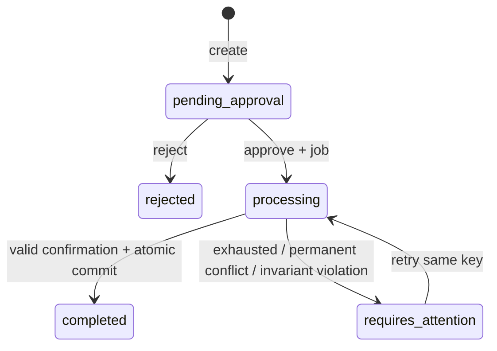

# RenewalDesk — Engineering Specification

**Версия:** 1.0 (утвержденная концепция; реализация и результаты проверок — в `docs/progress.md`). **Язык UI:** русский. **Язык кода:** английский. Документы можно писать на русском; именование файлов/идентификаторов — английское.

## 0. Назначение и источники
RenewalDesk — внутренний инструмент учета ресурсов, согласования и выполнения заявок на продление через тестовый внешний API. Цель: показать надежную бизнес-операцию, а не полноценный billing/CRM. Задание компании: 24–40 часов — предварительный ориентир, не измеренный SLA. При ограничении времени приоритет — работающий обязательный сценарий, явно перечислить незавершенное.

Приоритет источников: `references/company/task.pdf` (стр. 1–8) и контракт оригинального Python-симулятора > настоящая спецификация и инженерные docs > принятый дизайн `references/design/README.md`, HTML и screenshots. Handoff содержит frontend-симуляцию, не готовый backend. Изменения требований фиксировать в ADR, не подменять оригинал. Оригинальные материалы сохранены без изменений.

## 1. Scope / критерии
| Приоритет | Требование |
|---|---|
| P0 | Core данные, локальный вход, права и изоляция, заявки, состояния, история, 401/403/409, partial unique index, конкурентность |
| P0 | Атомарное approve + job, надежный provider client, стабильный ключ, recovery после 503 и рестарта, 3 POST, manual retry, атомарная финализация |
| P0 | Реальные интеграционные/API E2E тесты, Docker Compose, миграции, seeders, воспроизводимость и README |
| P0 | UI ресурсы/заявки/создание/решение/история/ошибки, визуальная близость к PDF и mobile 390px |
| P1 | Весь утвержденный v2 дизайн: Overview, ресурсы, заявки, detail, audit, поиск, фильтры, сортировка, dialogs, responsive, доступность |
| P1 | Demo dataset (15 ресурсов, Alpha/Beta/Orion, 7 учеток, 11 заявок всех статусов), Stoplight, Swagger, developer workflow, CI |
| P2 | Дополнительная полировка, подробные диаграммы, demo-видео/скриншоты, если основное готово |

Оценка компании: бизнес-правила 25%, reliability 25%, access 20%, UI 15%, тесты/воспроизводимость/docs 15%. P1 — согласованный объем, не повод жертвовать P0. Не добавлять регистрацию, SSO, email/SMS, реальные платежи/балансы, редактирование ресурсов в UI, billing, собственный брокер, микросервисы на каждый модуль, Kubernetes, обязательный cloud deploy. Репозиторий отдельный, публикация только владельцем.

## 2. Stack и архитектура
- React + TypeScript + Vite, React Router; TanStack Query (предлагаемый выбор для cache/polling), CSS design tokens; UI primitives с доступным dialog/drawer (выбрать компактную библиотеку, сохранить дизайн).
- NestJS + TypeScript (strict), Node.js 22, npm workspaces, lockfile; PostgreSQL 16, Sequelize v6 + sequelize-typescript + pg, Umzug или sequelize-cli (выбрать один, обеспечить SQL constraints и CLI). Версии закрепить и проверить совместимость; не утверждать, что эти версии новейшие.
- Modular monolith, общий backend-код, два runtime entrypoints: API и worker. PostgreSQL-backed durable jobs/outbox-style, без RabbitMQ. Python provider отдельно, оригинал не меняется.
- OpenAPI via @nestjs/swagger, Stoplight Elements `/docs`, Swagger UI `/docs/swagger`, spec `/docs/openapi.json` (same-origin).
- Docker multi-stage, Compose v2, PostgreSQL volume, healthchecks, migrate/seed one-shot, отдельные тестовые окружения, Makefile и GitHub Actions. Pino structured logs с redaction.
- Jest, Supertest, реальная PostgreSQL, оригинальный provider для happy/restart, отдельный test-only fault stub, Playwright.

Подробности: `docs/architecture.md`, `docs/development-workflow.md`.

## 3. Данные, роли, доступ (PDF стр. 2)
| Workspace | Resource ID | Name | Expires on | Amount minor | Currency |
|---|---|---|---|---:|---|
| Alpha (`alpha`) | res-a-01 | Хранилище A | 2027-03-01 | 128000 | RUB |
| Alpha (`alpha`) | res-a-02 | Сервис B | 2027-05-20 | 250000 | RUB |
| Beta (`beta`) | res-b-01 | Сервис C | 2027-06-01 | 150000 | RUB |

Core credentials (локальные вымышленные, пароль `demo1234`, hash в БД): `initiator.alpha@renewaldesk.test` (initiator Alpha), `approver.alpha@renewaldesk.test` (approver Alpha), `initiator.beta@renewaldesk.test` (initiator Beta), `universal.alpha@renewaldesk.test` (обе роли Alpha). Core (изменение владельца от 2026-11-12, ADR-009): 2 пространства, 18 ресурсов (Alpha 15 / Beta 3), 4 пользователя; на новой БД 0 заявок и свежий provider без операций. Три обязательных ресурса сохраняют исходные ID/даты/суммы. Изолированный DATASET=test использует минимальный набор из 3 ресурсов; расширенный Core дополнительно проверяется отдельным тестом seed. Demo: дополнительные данные по handoff, независимая DB и provider. Не подменять обязательные даты/суммы/ID. См. `docs/architecture.md` dataset rules.

Локальная аутентификация: JWT HttpOnly cookie + серверная сессия, пароль хешируется, CSRF для mutation; роли/пространство извлекаются из DB. У пользователя одного текущего пространства нет переключателя на чужие. Alpha не читает и не меняет Beta даже по известному ID. 401 — нет действующей авторизации; 403 — чужое пространство/нет роли/собственное решение; 404 — несуществующая сущность; 409 — конфликт перехода/active/snapshot. Все методы, списки, joins, counters, audit проверяются на tenant scope; не доверять данным клиента. См. `docs/security.md`.

## 4. Домен и неизменяемые инварианты (PDF стр. 3, 5)
- Заявка создается инициатором для ресурса своего пространства. Сервер фиксирует `previous_expires_on`, `new_expires_on = previous + 30 calendar days`, `amount_minor`, `currency`, `resource_id`, автора и стабильный уникальный `idempotency_key`. Snapshot и provider payload неизменяемы. Дата — DATE без времени, деньги — integer копеек; период провайдера `period_months=1` означает 30 дней, не календарный месяц. Стоимость не вводится клиентом.
- Статусы: `pending_approval`, `processing`, `completed`, `rejected`, `requires_attention`. Active = pending_approval/processing/requires_attention. Частичный уникальный индекс PostgreSQL: максимум одна активная заявка на ресурс, включая параллельное создание. После completed/rejected можно создать новую.
- Approve/reject только approver этого workspace, не автор заявки. Даже universal не решает свою. Сервер устанавливает actor/decided_by/time. Approve только pending_approval и совпадение snapshot текущего срока и стоимости (и валюты). При конфликте 409, никаких job/provider вызовов. Reject только pending_approval, не изменяет ресурс и не отправляет запрос. Одно успешное решение при гонке; второе 409.
- Approve → processing + durable job + audit одной транзакцией. Не вызывать provider в HTTP handler. Job уникален на request. После подтверждения provider — атомарно сохранить result, `completed`, новый срок, job done и audit. Повторная обработка не сдвигает срок. При неожиданном mismatch нельзя завершать; `requires_attention`, запись причины, подтверждение внешней операции не терять.
- При 503/timeout не считать операцию проваленной: результат неизвестен. После настраиваемой задержки GET по тому же ключу или идентичный POST; выбран GET-first reconciliation. Не более 3 POST на автоматический цикл, GET не входит. После трех без подтверждения — requires_attention. Approver может retry существующей задачи с тем же ключом/payload, reset счетчика цикла, total не сбрасывается; новая заявка заблокирована до разрешения. Retry не является новым согласованием; universal-автор с ролью approver может повторять уже согласованную другим заявку (исходное задание не запрещает retry автору; не дает approve/reject своей).
- Audit append-only через приложение: actor/time/status transition; системные события provider, job, попытки, подтверждение, конфликт. Не сохранять секреты/полный provider response в логах/аудите.

## 5. Provider protocol (PDF стр. 4–5)
Original `provider_simulator.py`: host 127.0.0.1:8091, in-memory, thread-safe lock. POST `/renewals` header `Idempotency-Key` и EXACT 4 поля `{resource_id, period_months:1, amount_minor,currency:"RUB"}`. Первый POST с новым ключом сохраняет completed operation, возвращает 503 `response_lost`; повтор с тем же ключом и телом → 200 с прежним operation_id, status completed, started_count=1. Тот же ключ с другим телом → 409. GET `/renewals/{encoded key}` → 200 или 404. `/stats?resource_id=...` → operation_count; `/health` → 200.

Не изменять исходный script. Docker launcher только меняет bind. Перезапуск provider теряет все операции; тесты recovery перезапускают API/worker, оставляя его и DB живыми. Гарантия внешнего однократного эффекта действует только в пределах сохраненного состояния идемпотентного провайдера. Не обещать exactly-once delivery. Алгоритм с lease/fencing, durable retry и edge cases: `docs/reliability.md`.

## 6. API
REST base `/api/v1`; product endpoints из handoff с этим префиксом. Все внешние request/response, query params, nested fields, errors — snake_case. Публичные IDs заявок `RN-1001` и далее, DB sequence, не использовать предсказуемость как security. Явные DTO, validation whitelist/forbidNonWhitelisted, no ORM serialization. OpenAPI описывает реальные ответы и errors, cookie auth/CSRF. Stoplight + Swagger UI same-origin, локальные assets без CDN-зависимости для приемки. См. `docs/api-contracts.md`.

## 7. UI
Использовать принятую v2 версию `references/design/`: маршруты `/login`, `/overview`, `/resources`, `/requests`, `/requests/:id`, `/audit`; русскоязычный интерфейс, RenewalDesk, dark palette, референс PDF стр.6. Desktop 1440×900: `min(1120px, calc(100% - 64px))`, Arial, H1 32, body 14–16, card radius 20/padding 24, цвета #0B1B1D #1D2C2E #F5F7F7 #A9B8B9 #80A3FF; white pill create. Mobile 390, без page horizontal overflow. Полноценная навигация, data tables/cards, search/filter/sort, details/timeline, dialogs approve/reject/retry, loading/error/empty/conflict, keyboard focus. Не переносить demo controls и localStorage API. Полный список требований: `docs/frontend.md`.

## 8. Проверка и delivery
- Core scenario: initiator creates res-a-01; date unchanged 2027-03-01; duplicate denied; Beta denied; self approval/rejection denied; parallel approvals one 200 + one 409; first POST stores op/503; stop and restart API/worker keeping provider+DB; same key GET/recovery; completed date 2027-03-31; repeated finalize no change; provider started_count=1 and operation_count=1. Rejected res-a-02 stays 2027-05-20, provider stats 0. Additional tests for three POST failures and retry, snapshot mismatch, rollbacks, stale worker, API errors, UI.
- Real database migrations + seeds, real provider and real HTTP API tests; test-only fault injection, E2E browser. `docs/testing.md` defines acceptance and gates.
- Fresh clone/checkout run via Docker Compose, docs for versions, env, commands, auth, API, diagram, architecture tradeoffs, restart and tests. GitHub Actions, test logs/artifacts, README. `docs/development-workflow.md` defines commands, not yet implemented.
- No release claims until verification. Record remaining limitations, including in-memory provider, development credentials/local HTTP, crash counter accounting, and extra features not implemented.

## 9. Definition of Done
All P0 satisfied and verified, P1 implemented/verified or explicitly disclosed, documentation matches actual behavior, repository includes source + migrations + tests + seed data + reproducible run. No hidden failures, no simulated production logic. User can demonstrate main flow through UI, API docs and provider stats. See `docs/implementation-plan.md` and `docs/progress.md`.
